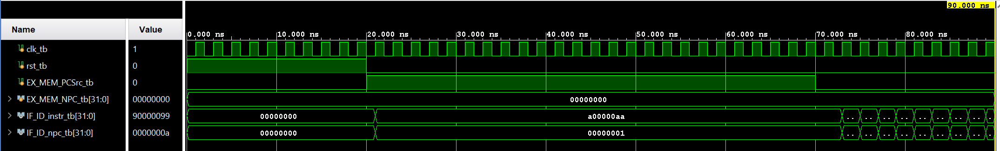

# Coding Assignment 1 — Instruction Fetch

## Design Scope and Assumptions
- **In scope:** This assignment implements the Instruction Fetch (IF) Stage of the MIPS Pipeline, which includes the Latch, Instruction Memory, Program Counter (PC), Multiplexer (Mux), and Incrementer/Adder.
- **Out of scope:** This assignment does not include the other MIPS Pipeline stages, in addition to inputs provided by the Execute and Memory stages.
- **Assumptions:** The design uses a 32-bit architecture for data and addresses. The system relies on a positive edge-clock and a synchronous high reset to initialize registers.
- **Limitations:** While the instruction memory conceptually holds 2^32 words, it is currently populated with a limited set of dummy data (10 instructions starting at index 0) for simulation purposes and only holds 256 because the simulator began to cap out when given the 2^32.
## Requirements
| Requirement | Description | Verification Method |
|---|---|---|
| REQ-01 | The design shall pass the input as the output on the clock cycle and reset to 0 when rst is high. | Testbench simulation and waveform inspection. |
| REQ-02 | The Instruction Memory shall hold 2^32 words, be populated with dummy data, and return the instruction at a given address. | Testbench simulation and waveform inspection. |
| REQ-03 | The IF/ID Latch shall pass the data (updated PC and instruction) through on the clock cycle. | Testbench simulation and waveform inspection. |
| REQ-04 | The Final IF Stage shall successfully integrate all 5 components without un-driven signals or short circuits. | Testbench simulation and waveform inspection. |
## Architecture
### Timing or Behavioral Summary
The Instruction Fetch stage uses the Program Counter (PC) to address the Instruction Memory and retrieve the next 32-bit instruction to be executed. Simultaneously, the current PC is incremented by the Adder/Incrementer. A Multiplexer (Mux) selects the next PC value—either the sequentially incremented PC or a target address provided by the EX/MEM stage (controlled by PCSrc). Finally, the IF/ID Latch captures both the fetched 32-bit instruction and the 32-bit incremented PC on the rising edge of the clock to pass them to the Instruction Decode stage.

## Implementation
### Source Code
| File | Description |
|---|---|
| [`fetch.v`](fetch,v) | Final IF Stage module instntiating and connecting all 5 components. |
| [`mux.v`](mux.v) | Multiplexer to select between standard PC increment and EX_MEM target. |
| [`pc.v`](pc.v) | Program Counter register module with synchronous reset. |
| [`incrementer.v`](inrementer.v) | Adder module to increment the PC. |
| [`instrMem.v`](instrMem.v) | Instruction Memory module pre-loaded with dummy hex values. |
| [`ifIdLatch.v`](ifIdLatch.v) | Pipeline latch passing PC and instruction on the clock edge. |
| [`fetch_tb.v`](fetch_tb.v) | Verification testbench providing clock, reset, and EX_MEM inputs. |
### Implementation Notes
- Reset Implementation: A synchronous reset (rst) signal was added to the sequential logic modules (pc.v and ifIdLatch.v) and driven by the testbench to clear initial "Unknown" (X) states during the first few nanoseconds of simulation.
- Mux Wiring: The structural wiring in fetch.v connects the next_pc (incremented PC) and ex_mem_npc to the Mux inputs, and routes the output to the PC register.
- Inline Initialization: The PC module includes reg [31:0] tmp = 0; to instantly resolve time-zero delta cycles in the Vivado simulator
## Verification
### Verification Strategy
The design is verified using **behavioral simulation via Xilinix Vivado**.
Verification covers:
- Reset and initialization case (asserting rst_tb = 1 to clear X states).
- Normal sequential fetch operating case (EX_MEM_PCSrc_tb = 0)
- Branch/jump target fetch case (EX_MEM_PCSrc_tb = 1 routing EX_MEM_NPC_tb into the PC
### Testbench and Waveform

The testbench source is available in [`fetch_tb.v`](fetch_tb.v).
### Results
| Test Case | Expected Result | Observed Result | Status |
|---|---|---|---|
| TC-01 — Initialization | Output signals IF_ID_instr and IF_ID_npc hold 00000000 while rst is high. | Signals clear to 00000000 upon reset assertion. | Pass |
| TC-02 — Instruction Fetch | After reset, memory index 0 is fetched, yielding a00000aa. | IF_ID_instr outputs a00000aa correctly. | Pass |
| TC-03 — PC Increment | PC increments, fetching subsequent addresses. | PC successfully increments and passes through the IF/ID Latch | Pass |
## Reproduction Instructions
### Tools and Versions
- **Simulator / synthesis tool:** Xilinix Vivado 2022.2
- **Language / standard:** Verilog
- **Operating system:** Windows
### Build and Run
```bash
# To compile and run using a standard Verilog simulator (e.g., Icarus Verilog):
iverilog -o fetch_sim fetch_tb.v fetch.v pc.v incrementer.v mux.v instrMem.v ifIdLatch.v
vvp fetch_sim

# To build and run in Xilinx Vivado (GUI):
# 1. Add all .v files as design sources.
# 2. Set fetch_tb.v as the top simulation source.
# 3. Click "Run Simulation" -> "Run Behavioral Simulation".
```
Expected output:
```text
# The testbench generates a waveform rather than console text. 
# Expected key signal transitions in the waveform:

  0 ns : rst_tb = 1, IF_ID_instr_tb = 00000000 (Reset state)
 20 ns : rst_tb = 0, PC begins fetching.
 25 ns : IF_ID_instr_tb = a00000aa (First instruction fetched from mem[0])
 35 ns : IF_ID_instr_tb = 10000011 (Second instruction fetched from mem[1])
 ...
 90 ns : Simulation finishes via $finish command.
```
## Repository Organization
```text
.
├── README.md
├── images/
│   ├── 
│   └── 
├── fetch.v
├── pc.v
├── instrMem.v
├── incrementer.v
├── mux.v
├── ifIdLatch.v
└── fetch_tb.v
```
## Known Issues and Future Improvements
- Incrementer Value: The incrementer currently adds 1 to the address (address + 32'd1). In a standard byte-addressed MIPS architecture, this should increment by 4 to fetch the next 32-bit word.
- Instruction Memory Storage: The Instruction Memory currently holds only 256 words. In the standard architecture, it should hold 2^32 words.
- Future Extension: Integrate the completed IF/ID Latch outputs with the Instruction Decode (ID) pipeline stage.
